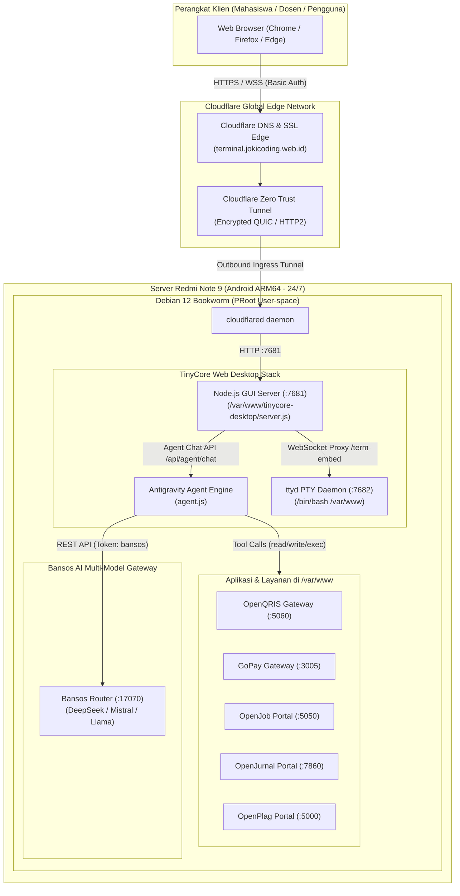
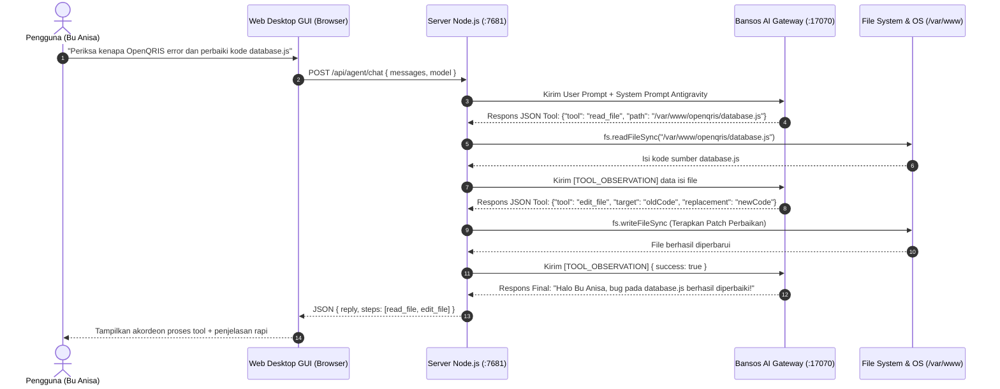

# MODUL KULIAH LAYANAN VIRTUAL
## Implementasi Virtual Linux Desktop Berbasis Web pada Lingkungan Hemat Daya (Android ARM64) & Integrasi Pemeliharaan Kode Otonom Berbasis Agen AI Antigravity

**Mata Kuliah:** Layanan Virtual / Komputasi Awan (Virtualization & Cloud Computing)  
**Referensi Repositori:** [`https://github.com/NourAnisa/linux_Server_Android.git`](https://github.com/NourAnisa/linux_Server_Android.git)  
**Implementasi Live:** [`https://terminal.jokicoding.web.id/`](https://terminal.jokicoding.web.id/)  
**AI Gateway Endpoint:** [`https://bansos.jokicoding.web.id/v1`](https://bansos.jokicoding.web.id/v1)  

---

## 🎯 Capaian Pembelajaran Mata Kuliah (CPMK)
Setelah menyelesaikan modul praktikum ini, mahasiswa diharapkan mampu:
1. **Menganalisis Arsitektur Virtualisasi Ringan:** Memahami perbedaan mendasar antara *Hypervisor Tipe 1/2*, *Container (LXC/Docker)*, dan *User-space Emulation (PRoot/Chroot)* pada arsitektur hemat daya ARM64 (Android).
2. **Membangun Gateway Terminal Virtual Berbasis Web:** Mengimplementasikan pseudo-terminal (`pty`) berbasis WebSocket menggunakan `ttyd` dan merancang antarmuka Web GUI Desktop interaktif.
3. **Mengatasi Tantangan Jaringan CGNAT:** Menerapkan teknologi ingress modern menggunakan *Cloudflare Zero Trust Tunnel* untuk mempublikasikan server lokal ke internet tanpa IP publik statis dan tanpa *port forwarding*.
4. **Merancang Protokol Komunikasi Agen AI Otonom:** Membangun integrasi antara agen AI (**Antigravity**) dan server web untuk membaca, mendiagnosis, memodifikasi (*patch*), dan mengelola kode sumber aplikasi di `/var/www` secara mandiri berbasis protokol *ReAct Tool Calling*.

---

## 🏛️ 1. Fondasi Teori & Perbandingan Paradigma Virtualisasi

Dalam perkuliahan Layanan Virtual tradisional, mahasiswa umumnya mengenal virtualisasi berbasis mesin virtual berat (VMware, VirtualBox, KVM). Namun, pada komputasi tepi (*Edge Computing*) dan komputasi hemat daya (*Green Computing*), *overhead* hypervisor sangat membebani CPU dan RAM.

### Tabel Perbandingan Pendekatan Virtualisasi

| Karakteristik | Virtual Machine (KVM/VMware) | Container (Docker/LXC) | PRoot (Android Termux) |
|---|---|---|---|
| **Level Abstraksi** | Hardware Emulation | Kernel Namespace / Cgroups | Syscall Translation (`ptrace`) |
| **Akses Root Kernel** | Wajib | Wajib (Kernel Support) | **Tidak Butuh Root** (User-space) |
| **Konsumsi Daya (Watt)** | 150W – 450W (x86 Server) | 30W – 100W (SBC/Mini PC) | **3W – 7W (Smartphone Android)** |
| **Overhead Memori** | Tinggi (GB per OS) | Rendah (MB per Container) | **Sangat Ringan (Native RAM)** |
| **Kompatibilitas** | x86 / AMD64 | Membutuhkan kernel modul | Berjalan di hampir semua kernel Android |

> [!NOTE]
> **Mengapa PRoot pada Android?**  
> Ponsel pintar modern seperti Redmi Note 9 memiliki 8 core CPU ARM64, RAM 4–6 GB, baterai internal (berfungsi sebagai UPS bawaan), dan modul modem 4G LTE. PRoot mengintersepsi panggilan sistem (*system call*) seperti `chroot`, `mount`, dan manipulasi ID pengguna via `ptrace`, memungkinkan kita menjalankan sistem operasi **Debian GNU/Linux 64-bit lengkap** di dalam user-space aplikasi Termux tanpa perlu melakukan *rooting* pada perangkat.

---

## 🏗️ 2. Topologi & Arsitektur Sistem Terintegrasi

Diagram berikut mengilustrasikan alur komunikasi lengkap dari klien browser, Cloudflare Edge Network, server web lokal di Redmi Note 9, hingga integrasi Agen AI Antigravity:



---

## ⚡ 3. Protokol Komunikasi Antara Antigravity dan Web Server

Salah satu inovasi penting dalam arsitektur ini adalah **bagaimana AI Agent (Antigravity) dapat menginspeksi dan memperbarui source code di server secara otonom**. Terdapat dua jalur komunikasi utama:

### 1. Jalur In-Browser Agent (REST API + ReAct Loop)
Pengguna yang mengakses web `https://terminal.jokicoding.web.id/` membuka jendela **Antigravity AI**. Komunikasi berjalan melalui siklus **ReAct (Reasoning + Acting)**:



### 2. Jalur Developer CLI / Remote Agent (Terminal WebSocket Tunnel)
Ketika pengembang atau asisten coding Antigravity di laptop lokal ingin mengunggah atau memperbarui file secara langsung tanpa login interaktif manual:
1. Skrip lokal (`push_remote_file.py`) membuka koneksi aman WebSocket ke `wss://terminal.jokicoding.web.id/ws` dengan header autentikasi `Authorization: Basic <base64(admin:bansos123)>`.
2. File diubah menjadi string *Base64* dan ditransmisikan dalam pecahan (*chunks*) berukuran 8.000 karakter ke `/tmp/upload_xxx.b64`.
3. Skrip mengirimkan perintah decoding: `base64 -d /tmp/upload_xxx.b64 > /var/www/...` secara atomik.
4. Skrip mengeksekusi `exec_remote_cmd.py` untuk memicu *graceful reload* layanan Node.js.

---

## 🛠️ 4. Langkah-Langkah Pembuatan & Praktikum (Step-by-Step Lab Manual)

Berikut panduan praktis yang dapat diikuti oleh mahasiswa di laboratorium:

### Tahap 1: Persiapan Lingkungan Android & Debian PRoot
1. Pasang aplikasi **Termux** (dari F-Droid / GitHub Releases resmi).
2. Perbarui paket Termux:
   ```bash
   pkg update -y && pkg upgrade -y
   pkg install proot-distro git curl wget jq nodejs -y
   ```
3. Pasang distribusi Debian:
   ```bash
   proot-distro install debian
   proot-distro login debian
   ```
4. Di dalam Debian, pasang lingkungan pengembangan dasar:
   ```bash
   apt update && apt install -y build-essential python3 python3-pip nodejs npm procps net-tools curl
   mkdir -p /var/www
   ```

### Tahap 2: Menjalankan Terminal Virtual Web Daemon (`ttyd`)
`ttyd` bertugas mengubah terminal Bash Linux menjadi stream WebSocket yang dapat dirender di browser:
```bash
# Jalankan ttyd pada port 7682 yang hanya mendengarkan localhost
ttyd -p 7682 -W /bin/bash &
```

### Tahap 3: Membangun Desktop Web GUI & Gateway Node.js
Buat berkas server di `/var/www/tinycore-desktop/server.js`:
```javascript
const http = require('http');
const net = require('net');
const fs = require('fs');
const path = require('path');
const agent = require('./agent.js');

const PORT = 7681;
const TTYD_PORT = 7682;

const server = http.createServer((req, res) => {
    const url = new URL(req.url, `http://${req.headers.host || 'localhost'}`);

    // Sajikan Antarmuka Web Desktop
    if (url.pathname === '/' || url.pathname === '/index.html') {
        const filePath = path.join(__dirname, 'public', 'index.html');
        return fs.createReadStream(filePath).pipe(res);
    }

    // Endpoint API Agent Antigravity
    if (url.pathname === '/api/agent/chat' && req.method === 'POST') {
        let body = '';
        req.on('data', chunk => { body += chunk; });
        req.on('end', async () => {
            const { messages, model } = JSON.parse(body || '{}');
            const result = await agent.runAgentTurn({ messages, model });
            res.writeHead(200, { 'Content-Type': 'application/json' });
            res.end(JSON.stringify({ status: 'ok', ...result }));
        });
        return;
    }

    // Reverse Proxy untuk Terminal ttyd
    const proxyReq = http.request({
        hostname: '127.0.0.1',
        port: TTYD_PORT,
        path: req.url === '/term-embed' ? '/' : req.url,
        method: req.method,
        headers: req.headers
    }, (proxyRes) => {
        res.writeHead(proxyRes.statusCode, proxyRes.headers);
        proxyRes.pipe(res);
    });
    req.pipe(proxyReq);
});

// Proxy WebSocket untuk Terminal aterm
server.on('upgrade', (req, socket, head) => {
    const proxySocket = net.connect(TTYD_PORT, '127.0.0.1', () => {
        proxySocket.write(`${req.method} ${req.url} HTTP/${req.httpVersion}\r\n`);
        socket.pipe(proxySocket);
        proxySocket.pipe(socket);
    });
});

server.listen(PORT, '0.0.0.0', () => {
    console.log(`[Web Desktop] Aktif pada port ${PORT}`);
});
```

### Tahap 4: Implementasi Modul Agen AI Otonom (`agent.js`)
Inti dari kecerdasan Antigravity adalah parsing pemanggilan tool (*balanced brace parser*) dan eksekusi instruksi:
```javascript
const { exec } = require('child_process');
const fs = require('fs');

async function executeTool(toolName, args) {
    if (toolName === 'read_file') {
        const content = fs.readFileSync(args.path, 'utf8');
        return { path: args.path, content };
    }
    if (toolName === 'edit_file') {
        let fileContent = fs.readFileSync(args.path, 'utf8');
        if (!fileContent.includes(args.target)) return { error: 'Target string not found' };
        fileContent = fileContent.replace(args.target, args.replacement);
        fs.writeFileSync(args.path, fileContent, 'utf8');
        return { success: true, message: 'File patched successfully' };
    }
    if (toolName === 'exec_cmd') {
        return new Promise(resolve => {
            exec(args.command, { cwd: '/var/www', timeout: 30000 }, (err, stdout, stderr) => {
                resolve({ stdout: stdout.trim(), stderr: stderr.trim(), exitCode: err ? 1 : 0 });
            });
        });
    }
}
```

### Tahap 5: Penerbitan Layanan Melalui Cloudflare Zero Trust Tunnel
Untuk membuka akses publik tanpa risiko membuka port router rumah:
1. Pasang paket `cloudflared` ARM64 di Debian:
   ```bash
   curl -L --output cloudflared.deb https://github.com/cloudflare/cloudflared/releases/latest/download/cloudflared-linux-arm64.deb
   dpkg -i cloudflared.deb
   ```
2. Jalankan ingress tunnel:
   ```bash
   cloudflared tunnel run --token <TUNNEL_TOKEN_ANDA> &
   ```
3. Arahkan *Public Hostname* pada dashboard Cloudflare:
   * **Domain:** `terminal.jokicoding.web.id` $\rightarrow$ **Service:** `HTTP://127.0.0.1:7681`
   * **Domain:** `bansos.jokicoding.web.id` $\rightarrow$ **Service:** `HTTP://127.0.0.1:17070`

---

## 🔬 5. Studi Kasus Praktikum Mahasiswa

### Studi Kasus 1: Pengecekan Kesehatan (*Health Check*) Sistem Multi-Layanan
**Skenario:** Mahasiswa menginstruksikan asisten AI melalui obrolan:  
> *"Antigravity, audit seluruh service di /var/www dan periksa apakah port OpenQRIS (5060) dan GoPay (3005) aktif."*

**Langkah Evaluasi yang Dijalankan AI:**
1. AI memanggil tool `service_status` $\rightarrow$ membaca tabel proses Linux (`ps aux`).
2. AI memanggil tool `exec_cmd` dengan perintah `netstat -tuln | grep -E '5060|3005'`.
3. AI menganalisis hasil luaran dan menyusun laporan ringkas berbasis tabel Markdown.

### Studi Kasus 2: Perbaikan Bug Kode Secara Otonom (*Autonomous Code Patching*)
**Skenario:** Terjadi kesalahan typo konfigurasi port di aplikasi pembayaran. Mahasiswa memberikan perintah:  
> *"Di file /var/www/openqris/server.js ada port yang salah tertulis 5061, tolong ganti kembali ke 5060 lalu restart service-nya."*

**Langkah Evaluasi yang Dijalankan AI:**
1. AI memanggil tool `read_file` untuk memastikan baris yang dimaksud.
2. AI memanggil tool `edit_file` dengan target `PORT = 5061;` dan replacement `PORT = 5060;`.
3. AI memanggil tool `restart_service` untuk me-restart proses Node.js.
4. AI memverifikasi kembalinya PID baru pada tabel sistem.

---

## 📝 6. Soal Latihan & Tugas Mahasiswa

1. **Analisis Kinerja:** Ukur perbedaan *latency* dan *memory footprint* antara terminal SSH langsung vs Web Terminal WebSocket (`ttyd` melalui Cloudflare Tunnel). Jelaskan dampaknya terhadap pengalaman pengguna (*Quality of Service*).
2. **Keamanan Layanan:** Mengapa otentikasi lapis ganda (*HTTP Basic Auth* pada level Web Server + *Cloudflare Access Zero Trust Policy*) sangat disarankan pada virtualisasi terminal berbasis web?
3. **Rekayasa Prompting Tool Calling:** Tambahkan satu tool baru bernama `backup_file` ke dalam `agent.js` yang menyalin berkas ke folder `/var/backups` sebelum tool `edit_file` diizinkan mengubah berkas asli. Jelaskan implementasinya!

---
*Modul ajar ini disusun oleh Nor Anisa untuk perkuliahan Layanan Virtual dan Komputasi Awan.*
